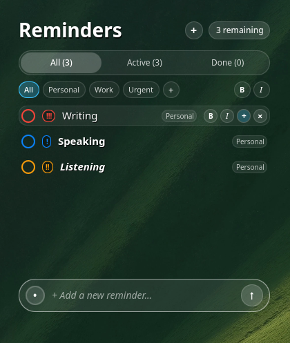
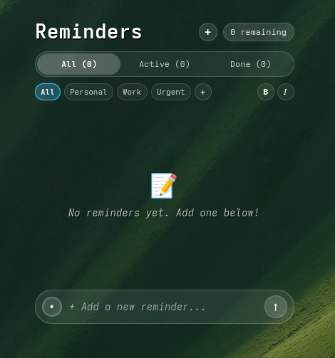

# macOS Floating Reminders for KDE Plasma 6

[](https://kde.org/plasma-desktop/)
[](https://www.qt.io/)
[](https://archlinux.org)
[](https://github.com/iam-sam17/macos-transparent-todo-plasmoid)
[](./LICENSE)

A frameless, floating macOS-style Reminders & To-Do List widget built natively for **KDE Plasma 6 (Wayland and X11)**. Engineered with QtQuick, Kirigami, and Plasma 6 Applet APIs, delivering 100% transparent desktop integration with nested subtasks, customizable categories, native KDE configuration dialog (KCM), priority-based auto-sorting, and dual-layer local persistence.

<p align="center">
  
  &nbsp;&nbsp;
  
</p>

---

## Key Features & Architecture

### 1. Zero-Container Frameless Canvas
* **Pure Desktop Float:** Employs `PlasmaCore.Types.NoBackground` to eliminate standard Plasma card borders, panel containers, and background masks. Text and controls float seamlessly across dynamic wallpapers.
* **Contrast-Optimized Typography:** Uses calibrated high-contrast drop shadows (`Text.DropShadow`, `rgba(0,0,0,0.85)`) to guarantee crystal-clear legibility across both bright, dark, and animated wallpaper themes.

### 2. Nested Subtasks System
* **Hierarchical Task Breakdown:** Expand tasks with subordinate action items (`subtasks`), each preserving its own independent completion state, 3-tier priority flag, and removal trigger.
* **Inline Subtask Management:** Create and toggle subtasks directly from the parent task row without opening secondary popup windows.

### 3. Multi-Tier Category Filtering
* **Instant Category Navigation:** Organize workflows with pre-configured pills (`All`, `Personal`, `Work`, `Urgent`).
* **On-the-Fly Creation:** Create custom categories instantly using the inline `+` button, fully integrated with the dual-layer filter engine (`All`, `Active`, `Done`).

### 4. Native KDE Configuration Panel (KCM)
Right-click the widget and select **Configure macOS Floating Reminders...** to access deep customization:
* **Font Family Selector:** Real-time font picker listing all system fonts (`Qt.fontFamilies()`).
* **Typography Controls:** Adjustable font size (11px – 32px), per-task Bold (`B`) & Italic (`I`) toggles.
* **Palette Customization:** Custom color pickers for task text, date header accents, and shadow effects.
* **Auto-Sort Engine:** Automatically hoist higher-priority items to the top of active views.

### 5. Dual-Layer Persistence Architecture
* **Primary Engine (Plasma KConfig):** Synchronizes configuration and model states with KDE Plasma's native configuration framework (`contents/config/main.xml`).
* **Secondary Engine (SQLite):** Client-side fallback using `QtQuick.LocalStorage` (`MacOSFloatingRemindersDB`), providing resilient local transaction handling and schema retention.

---

## Interface Layout

```text
 ┌──────────────────────────────────────────────────────────┐
 │  Reminders                             (+) [3 remaining] │
 │  ──────────────────────────────────────────────────────  │
 │  [   All (3)   ]    [  Active (3)  ]    [   Done (0)   ] │
 │  ──────────────────────────────────────────────────────  │
 │  (All)  (Personal)  (Work)  (Urgent)  (+)       (B)  (I) │
 │                                                          │
 │  ○ [!!!] Writing                   [Personal] [B][I][+][✕]│
 │  ○ [!]   Speaking                  [Personal]            │
 │  ○ [!!]  Listening                 [Personal]            │
 │                                                          │
 │  ┌────────────────────────────────────────────────────┐  │
 │  │  •  + Add a new reminder...                    [↑] │  │
 │  └────────────────────────────────────────────────────┘  │
 └──────────────────────────────────────────────────────────┘
```

---

## Installation & Deployment

### Method 1: Automated Script (Recommended)

Clone the repository and run the automated installer:

```bash
git clone https://github.com/iam-sam17/macos-transparent-todo-plasmoid.git
cd macos-transparent-todo-plasmoid
chmod +x install.sh
./install.sh
```

> **Developer Mode:** To symlink the live repository into Plasma for instant live development, run:
> ```bash
> ./install.sh --dev
> ```

### Method 2: Plasma Package Tool (`kpackagetool6`)

Install or upgrade the package directly using KDE's native tool:

```bash
# Clean install
kpackagetool6 --type Plasma/Applet --install .

# Upgrade existing install
kpackagetool6 --type Plasma/Applet --upgrade .
```

### Method 3: Manual Deployment / Symlink

```bash
mkdir -p ~/.local/share/plasma/plasmoids/
rm -rf ~/.local/share/plasma/plasmoids/org.minhaz.macos.transparent.todo
ln -sfn "$(pwd)" ~/.local/share/plasma/plasmoids/org.minhaz.macos.transparent.todo
```

To refresh Plasma Shell without restarting your desktop session:
```bash
qdbus6 org.kde.plasmashell /PlasmaShell org.kde.PlasmaShell.refreshCurrentShell
# Or restart service:
systemctl --user restart plasma-plasmashell.service
```

---

## Interactions & Shortcuts

| Action | Trigger | Description |
| :--- | :--- | :--- |
| **Complete Task** | Checkbox Click | Toggles task between active and done states |
| **Add Subtask** | `+` on Task Row | Expands nested subtask input field |
| **Cycle Priority** | Priority Pill Click | Cycles priority (`None` → `Low !` → `Med !!` → `High !!!`) |
| **Quick Add** | `Enter` / Click `↑` | Submits task buffer into active category |
| **Category Filter** | Category Pill Click | Filters task view to selected category |
| **New Category** | Category `+` Click | Creates and persists a custom category |
| **Toggle Font Style**| Click `B` / `I` | Toggles Bold or Italic typography styling |
| **Delete Task** | Click `✕` Button | Purges task & subtasks from disk storage |
| **Configure Settings**| Right-Click → Configure | Opens native Plasma KCM appearance dialog |

---

## Repository Structure

```text
macos-transparent-todo-plasmoid/
├── assets/
│   ├── preview_tasks.png   # Active tasks state preview
│   └── preview_empty.png   # Empty state canvas preview
├── contents/
│   ├── config/
│   │   ├── config.qml      # Plasma KCM settings category model
│   │   └── main.xml        # KConfig schema definition (14 properties)
│   └── ui/
│       ├── configGeneral.qml # Native Plasma appearance configuration GUI
│       └── main.qml        # Core Plasma 6 widget with subtasks & categories
├── install.sh              # Smart deployment script with dev-symlink & cache refresh
├── metadata.json           # Plasma 6 applet descriptor & KPlugin metadata
├── LICENSE                 # MIT License
└── README.md               # Technical documentation
```

---

## Changelog

### v2.0.0 (2026-10-17)
* **Nested Subtasks Engine:** Added multi-tier subtask hierarchy with individual completion toggles and priority indicators.
* **Dynamic Category System:** Implemented category pills (`Personal`, `Work`, `Urgent`, custom) with real-time filtering.
* **Native Plasma Settings (KCM):** Created `configGeneral.qml` with font family selector, custom font sizes, text color pickers, and accent colors.
* **Priority Sorting Engine:** Added automatic priority hoisting to sort urgent reminders to the top.
* **Installer Upgrade:** Redesigned `install.sh` with automated conflict cleanup and `--dev` symlink support.
* **Asset Refresh:** Updated visual preview assets showcasing empty state and active multi-tier tasks.

### v1.0.2
* **Qt 6 Enumeration Fix:** Resolved property assignment warnings by binding `Plasmoid.backgroundHints: PlasmaCore.Types.NoBackground`.
* **Empty-State Retention:** Fixed first-run sample tasks repopulating after clearing tasks.

---

## License

This project is licensed under the [MIT License](./LICENSE).

Author: **[Minhaz](https://github.com/iam-sam17)**
